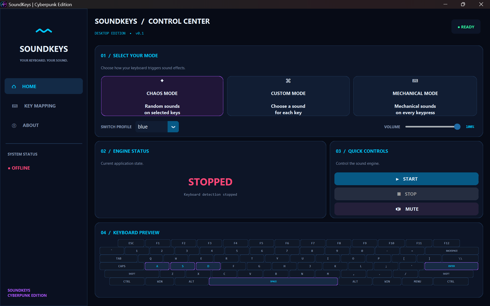
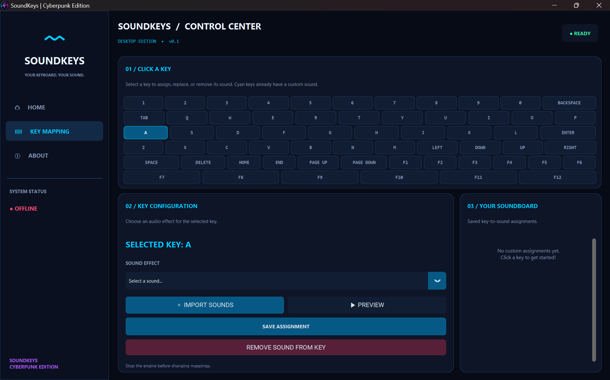

# SoundKeys

**Your keyboard. Your sound.**

SoundKeys is a Windows desktop application that turns keyboard input into sound effects. Choose a sound mode, configure key-to-sound assignments, manage a personal sound library, and control playback from the desktop interface.

> **Current release:** v1.1.0
> **Platform:** Windows 10/11 (64-bit)
> **Installer:** `SoundKeys-Setup-1.1.0.exe`

## Screenshots

### Control center



### Key mapping



## Features

- **Chaos Mode** — play randomized sound effects when selected keys are pressed.
- **Custom Mode** — assign individual sound effects to chosen keys.
- **Mechanical Mode** — use mechanical-keyboard sound profiles, with profile selection and volume control.
- **Interactive key mapping** — select a key, choose or import a sound, preview it, save the assignment, or remove it.
- **Sound library** — import and preview supported audio files, including MP3, WAV, OGG, and FLAC.
- **Global keyboard handling** — trigger sounds while working in other desktop applications.
- **Playback controls** — start and stop the sound engine, mute playback, and adjust volume.
- **System tray support** — keep the application accessible from the Windows notification area.
- **Backup and restore** — export and restore SoundKeys settings, key mappings, and custom sound-library data.

## Download and installation

1. Open the [GitHub Releases page](https://github.com/SharmaHarshit6392/sound_keys/releases).
2. Open the **SoundKeys 1.1.0** release.
3. Download `SoundKeys-Setup-1.1.0.exe` from its Assets section.
4. Run the installer and follow the setup prompts.
5. Launch SoundKeys from the Start menu or the shortcut created by the installer.

Only download installers from this repository's official GitHub Releases page. Windows may display a security warning for an independently distributed installer; verify that the file came from the official release before proceeding.

## Using SoundKeys

1. Launch SoundKeys.
2. Choose **Chaos Mode**, **Custom Mode**, or **Mechanical Mode**.
3. In Custom Mode, open **Key Mapping**, select a key, choose or import an audio effect, preview it, and save the assignment.
4. Use the Home screen to start or stop the engine and control mute/volume.
5. Use the Sound Library to import, preview, and manage your custom sound effects.
6. Use the backup controls to export your settings and restore them later when needed.

The exact keys and available sound profiles depend on the saved configuration and installed sound assets.

## Run from source

A Python source checkout requires the dependencies listed in `requirements.txt`.

```powershell
py -m venv .venv
.\.venv\Scripts\Activate.ps1
py -m pip install --upgrade pip
py -m pip install -r requirements.txt
py gui.py
```

For the packaged application, use the Windows installer from the Releases page instead of installing Python dependencies manually.

## Requirements

- Windows 10 or Windows 11, 64-bit.
- A working audio output device.
- For running from source: Python and the packages in `requirements.txt`.

The released installer is intended to include the application runtime dependencies.

## Privacy and keyboard permissions

SoundKeys uses a global keyboard hook so it can respond to configured key presses even when another application is active. Use it only on devices and accounts where you are authorized to run keyboard-hooking software. SoundKeys is designed to use key events to trigger local audio playback, not to record typed content.

## Audio licensing

Only import and distribute audio files that you created, have permission to use, or are otherwise properly licensed. Third-party sound files may have their own copyright and license terms; the MIT license for the application source code does not automatically apply to audio assets.

## Reporting issues

Bug reports and suggestions are welcome. When opening an issue, include:

- Your Windows version.
- The SoundKeys version.
- Steps to reproduce the issue.
- Any relevant error message.

Do not attach private information or audio files unless you have permission to share them.

## License

The application source code is licensed under the [MIT License](LICENSE).
